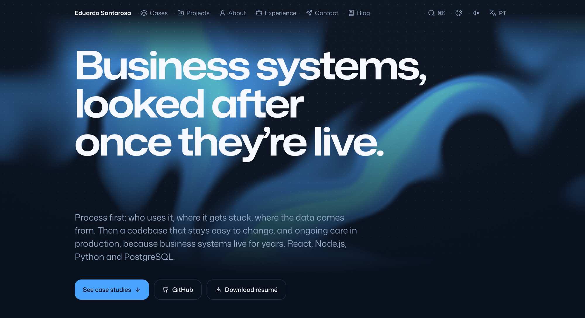

# edumes.dev

The source of [edumes.dev](https://edumes.dev/en/), the portfolio of Eduardo Santarosa, a full-stack developer who builds web systems for companies with React, Node.js, Python and PostgreSQL.

[](https://edumes.dev/en/)

[Site](https://edumes.dev/en/) · [Case studies](https://edumes.dev/en/#cases) · [Blog](https://edumes.dev/en/blog/) · [Résumé (PDF)](https://edumes.dev/eduardo-santarosa-resume.pdf) · [Open examples](examples/)

The site has case studies of systems in production, a blog and a résumé, in English and Portuguese. The case studies leave out client names and proprietary code. The ideas behind them are in [`examples/`](examples/): small runnable programs, written from scratch with made-up data.

## Engineering highlights

- **Fully static.** Next.js 16 (App Router) with `output: 'export'`. The build is plain HTML, CSS and JS in `out/`, with no server and no middleware.
- **Two languages with no `if` on the language.** [next-intl](https://next-intl.dev) with Portuguese at `/` and English at `/en/`. Each case study has its own slug in each language. Every shared string lives in [`src/i18n/messages/`](src/i18n/messages/), and [`request.ts`](src/i18n/request.ts) makes both files type-check against each other, so a missing translation fails `next build`. Text that only one component uses stays next to it, through `defineCopy` ([`copy.ts`](src/i18n/copy.ts)). On a first visit, the site picks the language from the browser.
- **36 themes, all readable.** Each preset has a light and a dark mode ([`presets.json`](src/themes/presets.json)). [`check-themes.mjs`](scripts/check-themes.mjs) checks WCAG AA contrast in every preset and mode and fails if one is below it. An inline script applies the saved theme before the first paint, so the page never flashes the wrong one.
- **Motion that respects the reader.** Spring animations with [Motion](https://motion.dev) and a WebGL gradient behind the hero that stops drawing off-screen. Under `prefers-reduced-motion`, everything stands still. Interface sounds ([cuelume](https://www.npmjs.com/package/cuelume)) are off until you turn them on.
- **Built from the content.** One Open Graph image per page and language ([`og.tsx`](src/components/og.tsx)), a sitemap with `hreflang` alternates, `robots.txt` and [`llms.txt`](https://edumes.dev/llms.txt), all generated from the same data as the pages.
- **The résumé is a page.** `/en/resume/` and `/curriculo/` are regular pages. [`build-cv.mjs`](scripts/build-cv.mjs) prints them to PDF with headless Chrome, so the PDF can't drift from the site.
- **Command menu.** <kbd>⌘</kbd>/<kbd>Ctrl</kbd> + <kbd>K</kbd> (or <kbd>/</kbd>) jumps to any section or case study, copies the e-mail, and switches language or color mode.

## Running locally

Requires Node.js 23.6 or newer. The theme scripts and the examples run TypeScript directly.

```bash
npm install
npm run dev      # http://localhost:3000
npm run build    # static site in out/
```

| Script | What it does |
| --- | --- |
| `npm run dev` | Development server. It also shows drafts (see [Content](#content)). |
| `npm run build` | Static export to `out/`. Fails on type errors, missing translations and missing blog illustrations. |
| `npm run test:blog` | Checks every published MDX body and the rule requiring a standalone illustration. |
| `npm run cv` | Prints the résumé pages to PDF in `public/`. Run it after `build`. It needs Google Chrome; set `CHROME` to use another path. |
| `npm run check:themes` | WCAG AA contrast check of every preset and mode. |
| `npm run sync:themes` | Rebuilds `presets.json` from the AuthSales boilerplate presets plus [`overrides.mjs`](src/themes/overrides.mjs). It needs the boilerplate at `../boilerplate` or in `BOILERPLATE_ROOT`. `presets.json` is committed, so nothing else needs it. |
| `npm run icons:add -- <name>…` | Copies animated icons from [lucide-animated](https://lucide-animated.com) into `src/components/icons/`. |

## Project structure

```
src/
  app/          routes: (pt) at /, (en) under /en/, plus sitemap, robots and llms.txt
  components/   pages, header, command menu, OG images, and the visuals of each case study
  content/      case studies, blog posts and profile data
  i18n/         locale settings, shared strings (messages/) and defineCopy
  themes/       presets.json (generated), overrides.mjs and the theme script
scripts/        theme sync and check, résumé PDFs, icons
examples/       runnable code behind the case studies
public/         résumé PDFs and vCard
```

## Content

- **Case studies** live in [`src/content/cases.json`](src/content/cases.json), one entry per case with a `pt` and an `en` object, each with its own slug. The entry's `id` links it to its visuals in [`src/components/visuals/`](src/components/visuals/index.ts).
- **Blog posts** are an entry in [`src/content/blog.json`](src/content/blog.json) plus `src/content/blog/<id>.pt.mdx` and `<id>.en.mdx`. Dates are `YYYY-MM-DD`.
- **Drafts** follow the same format in `.private/drafts/` (`cases.json`, `blog.json` and `blog/`). The folder is git-ignored, and drafts only render under `npm run dev`, never in a build.
- **Interface text** goes in both `src/i18n/messages/pt.json` and `en.json`.
- **Theme changes** go in [`overrides.mjs`](src/themes/overrides.mjs), then `npm run sync:themes && npm run check:themes`.

Every blog article needs an animated illustration with fictional data in both languages. Add a scene keyed by the post's `id` and Portuguese/English copy in [`src/components/visuals/blog.tsx`](src/components/visuals/blog.tsx), then place a standalone `<Illustration />` in each MDX body near the explanation it supports. Reuse the shared player and case study visual primitives so scenario selection, pause/resume, keyboard access and reduced-motion behavior stay consistent. A code sample or comment containing the tag does not count. Run `npm run test:blog` and `npm run build`; the build rejects missing illustrations and unregistered scenes.

## Deployment

Vercel serves `out/` as static files. [`vercel.json`](vercel.json) only sets the `image/png` content type for the icon and Open Graph routes, which are files with no extension in the export.

## License

The source code is under the [MIT License](LICENSE), and so are the [`examples/`](examples/).

The content is not. The case studies, blog posts, site copy and résumé (`src/content/`, `src/i18n/messages/`, `public/`) are © Eduardo Moreira Santarosa, all rights reserved. You may reuse the code, but please don't publish the site as your own.

Third-party assets keep their own licenses: Mona Sans (SIL Open Font License), lucide-animated icons (MIT) and Simple Icons (CC0).
